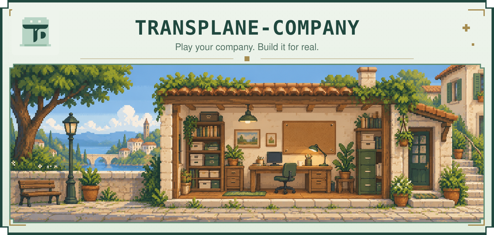

<div align="center">

<picture>
  <source media="(prefers-color-scheme: dark)" srcset="docs/media/hero-dark.svg" />
  
</picture>

**Run a one-person company like a game. Bring your own AI strategist.**

A narrative management game for solo founders (OPCs) that also works with real business records.

English · [简体中文](README.zh-CN.md)

[](https://www.rust-lang.org/)
[](https://react.dev/)
[](https://sqlite.org/)
[](https://www.postgresql.org/)
[](LICENSE)
[](https://transplane.sg/)
[](https://discord.gg/b6q452dYMT)
[](https://github.com/zhefox/TRANSPLANE-COMPANY/stargazers)

[Quick start](#quick-start) · [How to play](#how-to-play) · [Agent interface](docs/agent-interface.en.md) · [Report an issue](https://github.com/zhefox/TRANSPLANE-COMPANY/issues)

</div>

## Watch the game

<video src="https://github.com/user-attachments/assets/4e689b9c-9296-4154-9348-57546275bdf6" width="100%" controls></video>

## Your company, your next move

A customer wants a custom feature. Cash is getting tight. A potential partner comes back with an offer. What do you do?

Discuss it with your Agent, make a choice, and see the consequences. Your Agent acts as narrator and strategist: it reads company knowledge, researches relevant market information, explores scenarios, and keeps the company archive up to date. The pixel game interface brings the story, resources, relationships and progress into view.

**A game to explore. A workspace to operate.**

| Start with… | What happens |
|---|---|
| **A simulation company** | Build a fictional business from scratch. Face customers, commitments and tradeoffs; follow how earlier choices shape later events. |
| **Your real business** | Work with actual cash records, customers, subscriptions, goals and reports. Ask your Agent for analysis and the next business decision. |
| **A branch of your real company** | Explore a different strategy in a separate simulation. Its outcomes stay outside your real ledger. |

Simulation assumptions and real-world evidence are saved with the analysis. Missing real business data stays unknown until supplied.

## How to play

1. **Create a company.** Pick simulation or real operations, describe your business, and confirm your starting resources and goal with your Agent.
2. **Enter the story.** Your Agent prepares the current situation and meaningful business choices.
3. **Make your move.** Reply in plain language, propose your own plan, or choose in the game interface.
4. **Read the outcome.** Your Agent saves the results and carries commitments, relationships and delayed consequences into the next event.

You can play entirely in your existing Agent conversation. Ask for status, a report or a menu to receive the relevant game link; an optional screenshot renderer can return the actual interface. A choice saved in the browser waits for your Agent to process it.

| On your desk | What you can use it for |
|---|---|
| **Events & choices** | Narrative situations, saved decisions and turn results |
| **Company records** | Cash flow, MRR/ARR, products, customers and resources |
| **Relationships** | Customer, partner and company connections; revenue and cost attribution |
| **Quests & messages** | Main, side and daily tasks, opportunities, risk alerts and simulation event clues |
| **Progress** | Goal routes, achievements, levels and experience from recorded outcomes |
| **Forecasts & reviews** | Scenario assumptions, weekly/monthly reports and comparisons with results |
| **Company knowledge** | File previews, reusable business Skills and retained history |

## Quick start

[Download a release for your system](https://github.com/zhefox/TRANSPLANE-COMPANY/releases/latest). Choose the operating system and CPU architecture listed on that release, and verify its `SHA256SUMS.txt` checksum.

### Windows · double-click to play

Extract the entire ZIP into a writable folder, then double-click **`company-launch.exe`**. It starts the service and opens the game. On first launch, save the owner credential shown in the launcher and use it to sign in. Closing the launcher stops the service.

Your records live in `company-data/` next to the executable. Keep this folder when upgrading. Packaged binaries include the game interface; Rust, Node.js and Docker are not required.

### macOS & Linux · portable package

Extract the package matching your CPU, then run:

```bash
./company-launch
```

The launcher creates `company-data/` next to the executable and opens the game. For a headless host, use `./company-launch --no-browser --data-dir /your/persistent/company-data`. Save the first-launch owner credential from the output.

### Ask your Agent to deploy

Copy this into your existing Agent conversation:

```text
Deploy TRANSPLANE-COMPANY from https://github.com/zhefox/TRANSPLANE-COMPANY
on this computer. Detect its OS and CPU, choose a matching official release,
and verify SHA256SUMS.txt. Use a fixed persistent data directory and preserve
existing company records and credentials. Start company-launch, confirm the
service is reachable, and give me the game link and a safe sign-in method.
Read /api/v1/agent-entry and the relevant operation contracts. Then help me
choose simulation or real operations, confirm my business, resources and goal,
create or resume the company, and present the opening business event using
the deployment's player-output guidance. Wait for my choice.
```

For hosting on an authorized server:

```text
Host TRANSPLANE-COMPANY from https://github.com/zhefox/TRANSPLANE-COMPANY
on the server I authorize. Ask for the host and intended domain if missing.
Choose and verify a matching release, or build from its tagged source if no
binary matches. Use persistent storage, a service supervisor, an HTTPS reverse
proxy, and local-only backend access. Keep credentials outside URLs, company
documents and logs; create scoped Agent access. Verify startup, restart and
backup/restore, then give me the game URL, a safe sign-in method, and how to
stop, update and restore it. Read /api/v1/agent-entry and continue into company
setup and the first event using the deployment's player-output guidance.
```

[Platform requirements, source builds & hosting →](docs/getting-started.md)

### Windows · from source

Install **Rust 1.94+**, the system C compiler toolchain, **Node.js 24** and npm. In the repository directory:

```powershell
.\scripts\build-company.ps1 -BuildProfile Release -InstallDependencies
.\target\release\company.exe --data-dir .\company-data init
.\target\release\company-server.exe --data-dir .\company-data
```

Save the `owner_token` shown during initialization, then open **[localhost:4177](http://127.0.0.1:4177)** and sign in. Create a company and send its opening brief to your Agent.

### Docker · SQLite

```bash
docker compose build company
docker compose run --rm --entrypoint company company init
docker compose up -d company
```

Save the initialization token and open **[localhost:4177](http://127.0.0.1:4177)**. Persistent data lives in `company-data/` on the host.

[Packaged binaries, source builds & PostgreSQL →](docs/getting-started.md#install-a-release)

## Connect your Agent

Give your Agent the local data directory or the authorized service address. It reads the deployment's entry and discovers the current operation contracts as needed:

```text
GET /api/v1/agent-entry
GET /api/v1/discovery
GET /api/v1/agent-guide?topic=connect
```

For a local Agent:

```powershell
.\target\release\company.exe --data-dir .\company-data --lang en guide --topic connect
.\target\release\company.exe --data-dir .\company-data --lang en play --company <company-id>
```

No local Skill installation is needed. The optional [entry Skill](skills/transplane-company/SKILL.md) can retain the connection instructions in your client. Company-scoped credentials authorize remote reads and writes.

The platform stores, validates and presents company state. Your own Agent supplies reasoning, model calls, scheduling and authorized external actions. Independent deployments need no TransPlane World account.

## Built to keep your company portable

- **Your records and files.** SQLite by default, optional PostgreSQL, plus an open company directory for knowledge and original documents.
- **One set of business rules.** CLI, HTTP and file imports share validation, request deduplication and revision checks. Cash corrections retain history.
- **Reusable business knowledge.** Agents read hosted Skills on demand; owners can edit them and preserve useful operating experience.
- **Extension points.** Plugins contribute templates, metrics, views, imports and backup destinations. Executable plugins run as trusted local processes.
- **Backup and migration.** Versioned snapshots retain company records, file versions and plugin data; restore into a fresh deployment and grant new credentials.

## Explore the project

| Guide | English | 简体中文 |
|---|---|---|
| Setup & first game | [Getting started](docs/getting-started.md) | [使用指南](docs/getting-started.zh-CN.md) |
| Agent integration | [Agent interface](docs/agent-interface.en.md) | [Agent 接口](docs/agent-interface.md) |
| Hosted business Skills | [Skills](docs/hosted-skills.en.md) | [经营 Skills](docs/hosted-skills.md) |
| Plugin development | [Plugins](docs/plugins.en.md) | [插件接口](docs/plugins.md) |

[Deployment & recovery](docs/operations.md) · [Third-party notices](THIRD_PARTY_NOTICES.md)

## License

[PolyForm Noncommercial 1.0.0](LICENSE). Commercial use, including use to operate a revenue-generating business, requires separate permission from the rights holder.
